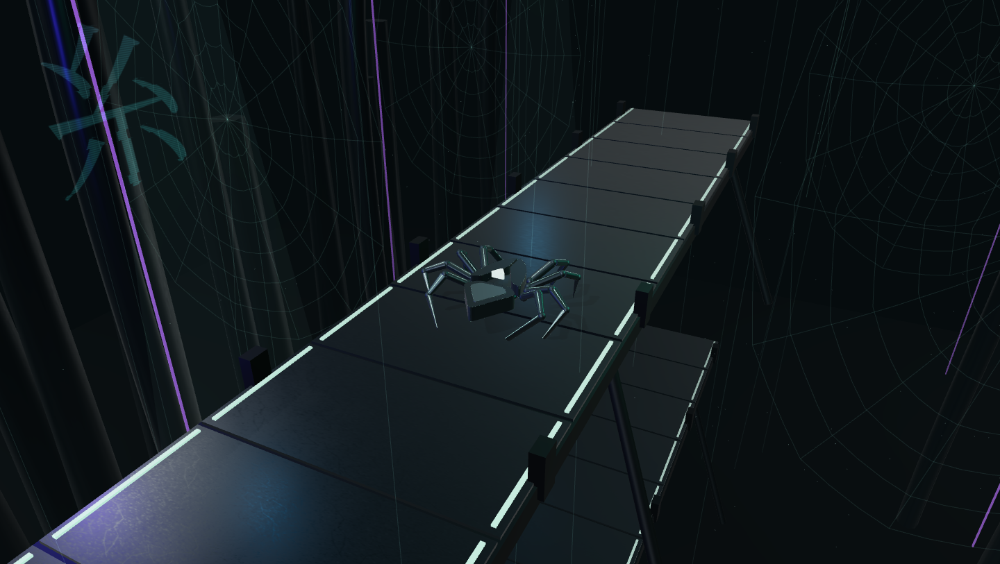

# Aranea spider: Silk Chamber

An original articulated 3D interpretation of the Aranea spider. The split
carapace, triangular reactor and abdomen shield come from the canonical
[spider glyph](../marks/aranea-glyph.svg). Eight three-segment mechanical legs
follow its angular stance. Dark titanium, mint enamel, basalt and violet light
share the visual language of the wallpaper collection. The stage is original
geometry; it does not use a wallpaper as a backdrop or texture.



## Assets

| File                                       | Use                                                                                      |
| ------------------------------------------ | ---------------------------------------------------------------------------------------- |
| [aranea-spider.blend](aranea-spider.blend) | Editable character, rig, animation clips, lights, camera and separate Silk Chamber stage |
| [aranea-spider.glb](aranea-spider.glb)     | Character with materials, skin and both animation clips; no stage or camera              |
| [silk-chamber.mp4](silk-chamber.mp4)       | Two-second seamless walking scene, 1280 × 720, 12 fps, silent H.264                      |
| [silk-chamber.gif](silk-chamber.gif)       | Small animated preview for sharing                                                       |
| [silk-chamber.png](silk-chamber.png)       | Still of the scene                                                                       |
| [model-info.json](model-info.json)         | Build version, skeleton and timing information                                           |

The model is authored with Blender Python, not an image-to-mesh conversion.
No external textures, models, network assets or runtime downloads are needed.
Original models and code follow the repository's license. Bundled Three.js and
the kanji font retain their own licenses. Blender itself is not bundled.

## Rig and clips

The character faces +Y with Z up. Its 26 bones are `root`, `body`, and
`leg.L1.hip` / `.knee` / `.tip` through `leg.R4.tip`. L/R are the glyph's
left and right sides; 1–4 run from front to back. The rigid armor and joints
are bound to individual bones. Pose these bones in Blender's Pose Mode.
Use `root` for placement and `body` for body movement.

The Action Editor contains two clips at 24 fps:

- **Idle:** frames 1–97, a four-second breathing and leg-settling cycle.
- **Walk:** frames 1–49, a two-second walk in place using alternating groups
  of four legs. Distal joint rotations are baked from an analytical two-link
  solve, keeping planted toes above the stage and lifting the swinging feet.

The last frame of each clip duplicates the first for editing. Omit that last
frame when encoding a loop. The GLB carries both named clips. Walking uses a 65% grounded stance with
constant backward foot motion, followed by a soft lifted recovery. The proximal
joint follows the foot sweep, while distal IK keeps the contact planted. Leg
phases are staggered and body sway is restrained. At the live model scale of
0.65, one-times animation speed matches 0.22 world units per second; the live
renderer measures route speed and facing rather than guessing a multiplier. The Blender
scene opens on Walk; the muted NLA tracks keep both actions available without
mixing them. Its camera also follows a closed two-second movement synchronized with the walking cycle.

## Live silk-lit structure

The default preview is now a live 3D journey through an original vaulted
structure. The spider crosses suspended bridges, steps onto its silk line,
descends nine units to a lower level, returns, then climbs back. The 160-second
route is continuous. A following camera alternates between close and wide
views; lit silk curtains, drifting motes and moving mint/violet light animate
the surrounding space. The walking and idle clips drive the existing rig.

Rare cyberpunk events add variation: faint scanning kanji projections,
calligraphy assembling from particles, travelling web-light pulses, and brief
swarms of motes. The first appears after 18–40 seconds; subsequent events have
35–95 seconds of quiet between them. Each lasts 7–12 seconds, only one runs at a
time, and consecutive event types differ. Timing and glyph choices vary each
run. The local font subset contains only 影, 光, 糸, 夢 and 電, with the original
[SIL Open Font License](live/kanji-font-LICENSE). The subset derives from
Noto Serif CJK JP Regular, © 2017–2024 Adobe. No installed Japanese font is needed.

From the repository:

```bash
scripts/aranea-screensaver preview
```

Requires Chromium and Python 3. All scene code, the GLB and the pinned Three.js
runtime are local. No CDN, model download or wallpaper image is used at runtime.
The launcher serves only the scene assets on an ephemeral loopback port, opens
an isolated temporary browser profile and removes it when the preview closes.
Move the mouse, click, or press a key to close. Launch-time mouse movement is
ignored for 1.5 seconds. The controls load independently of the 3D renderer so
Escape still works if rendering fails. Your normal browser profile is unused.

Rendering targets 30 fps and caps the canvas at 2.1 million pixels. This is a
manual preview; automatic idle activation is not installed, and existing
screensaver and lock configuration is unchanged.

The previous rendered loop remains available as a lightweight alternative:

```bash
scripts/aranea-screensaver video
```

That plays the two-second walking scene fullscreen with `mpv`. Move the mouse,
click, press Escape or an ordinary typing key to close. Its launch-time pointer
movement is ignored for one second.

The live scene is in [live/](live/). Third-party sources and their license are
listed in [live/vendor/README.md](live/vendor/README.md). Run the route/input
contracts and local server lifecycle checks with:

```bash
node --test tests/js/spider*.mjs
python3 tests/spider-live.test.py
python3 tests/spider-gait.test.py
bash tests/spider-preview.test.sh
```

## Rebuild

Requires Blender 4.5 LTS and FFmpeg. The original build used Blender 4.5.11.
Use an empty output directory when rendering a sequence, to avoid mixing
frames from earlier runs. `--cuda` is optional and requires a compatible GPU;
leave it out for CPU rendering.

```bash
blender -b --factory-startup --python-exit-code 1 \
  --python tools/spider/build.py -- \
  --output /tmp/aranea-spider-render --render-still --render-loop \
  --width 1280 --samples 24 --frame-step 2

ffmpeg -framerate 12 -pattern_type glob \
  -i '/tmp/aranea-spider-render/frames/frame-*.png' \
  -c:v libx264 -crf 18 -pix_fmt yuv420p -movflags +faststart \
  /tmp/aranea-spider-render/silk-chamber.mp4
```

`--frame-step 1` renders every frame; encode that sequence at 24 fps. The
committed video uses 12 samples with denoising; the still uses 12. The editable
scene retains its 24 fps animation timing independently of the video sampling.
The builder validates bone names, normalized influences, loop continuity and
walking foot clearance before exporting. The scene check also requires visible
movement on every leg and matching camera and walking loop endpoints. After replacing the committed model
files, independently reopen the Blender scene and round-trip the GLB:

```bash
blender -b --factory-startup --python-exit-code 1 \
  --python tools/spider/check-export.py
bash tests/spider-preview.test.sh
```

The complete construction source is [tools/spider/build.py](../../tools/spider/build.py).
