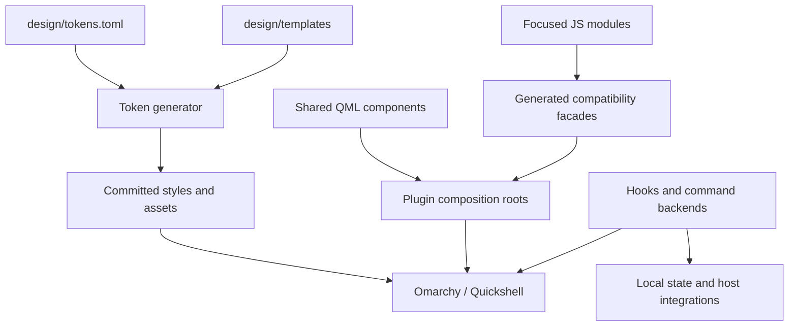

# Architecture

Aranea has three main responsibilities: generate a consistent desktop style,
compose Omarchy shell surfaces, and manage local integration and project state.
Those responsibilities have separate editing and runtime boundaries.

## System shape



| Layer              | Owns                                                       | Boundary                                 |
| ------------------ | ---------------------------------------------------------- | ---------------------------------------- |
| Tokens/templates   | Palette, dimensions, typography, motion, asset projections | No plugin state or host detection        |
| Shared QML         | Presentation, input frames, runtime paths                  | No plugin lifecycle or process ownership |
| Plugin roots       | Composition, services, IPC, interaction                    | Reuse shared contracts and tokens        |
| Focused JavaScript | Pure normalization and domain logic                        | No window lifecycle or I/O               |
| Generated facades  | Stable QML-compatible exports                              | Regenerate rather than hand-edit         |
| Hooks/scripts      | Install, activate, repair, persist, execute                | Keep presentation in QML/templates       |

## Token flow

`design/tokens.toml` and `design/templates/` feed
`scripts/generate-tokens`. Identity and the canonical spider are fixed in the
generator. Generated CSS, TOML, QML, SVG, raster, and cursor files are committed
runtime inputs and review artifacts, not editing sources.

```bash
scripts/generate-tokens --write
scripts/generate-tokens --check
```

Xcursor and Hyprcursor share geometry. The font-icon generator supplies glyph
geometry, and token generation resolves its accent. Wallpaper artwork is
cataloged separately through stable IDs in `backgrounds/manifest.toml`.

## Runtime composition

Plugin entry points compose local state, feature components, shared chrome, and
pure logic. Shared `BrandHeader`, `StatusRow`, `SurfaceCard`, `Typography`,
keyboard frames, and motion/focus primitives accept explicit properties and
signals. Hosts keep cursor identity, focus policy, activation, and lifecycle.
`RuntimePaths.qml` centralizes state and branding paths.

Extract repeated, stable contracts. Leave one-off interactions or behavior tied
to a particular service in the owning plugin. Window visibility must not become
the lifetime of an accepted background operation.

## Consolidated panel ownership

| Host                          | Pages                                     | Ownership                                                                       |
| ----------------------------- | ----------------------------------------- | ------------------------------------------------------------------------------- |
| `araneadev.network/Panel.qml` | Network, VPN, Bluetooth                   | One popup and selected tab; children retain data, credentials, actions, and IPC |
| `araneadev.power/Panel.qml`   | Power, Display, Health                    | One System popup; optional children load by URL and retain standalone support   |
| Audio                         | Outputs, inputs, application audio, media | Shared default-device state and active-capture badge                            |
| Agents                        | Selected provider usage and details       | Persisted real provider selection, separate inert showcase identity             |

Hosted children suppress their own bar icons/windows. Legacy VPN/Bluetooth open
routes select the host page. Network page changes coordinate polling, scanning,
prompts, and keyboard handling; `N`, `V`, and `B` select pages and hosted
Bluetooth uses `T` for power. System's `showPage power|display|health` validates
availability. Health samples resources while its page is selected and uses the
shared Health service through HealthBridge.

`repair-shell-config` removes redundant child entries only when their host is
present. The bar exposes Notifications, Agents, Network, Audio, and System,
with a disclosed tray and a conditional Health issue shortcut.
`BarGroupIcon.qml` owns Network/System vector geometry; the button supplies
semantic color. Agents persists `selectedProviderId` through inline settings;
capture/showcase state cannot overwrite it.

## Desktop search and actions

The menu's root is a compact grouped single column. Root search combines apps,
commands, Settings, projects, windows/workspaces, and supported desktop actions;
submenus and dmenu retain their scoped list behavior.

`DesktopSearchSources.qml` adapts existing app/menu/history state and live
compositor snapshots. Its active lease gates subscriptions; refreshes coalesce
at 100 ms and stale generations are discarded. `DesktopSearchRanking.js` and
`MenuSearch.js` provide pure matching through `DesktopSearchLogic.js`.
`DesktopSearchTargets.js` produces typed records and argument-array requests.

The menu owns ranking and selected canonical keys. Activation resolves a fresh
synchronous snapshot instead of trusting cached results. Missing compositor data
removes only live results; vanished targets fail without closing the menu.
Apps/commands reuse their existing handlers. Detached argument-array dispatch
means submission was accepted, not that the external command finished.

Desktop actions have a separate keep-loaded controller. `DesktopActionRecords.js`
projects DND, audio, and wallpaper state; `DesktopActionState.js` tracks one
request per family by generation. Notification preference echoes, Audio's
`AudioDefaults.qml`, and tracked wallpaper processes/readback confirm results.
DND/audio/wallpaper deadlines are three/four/fifteen seconds. Closing the menu
releases observation leases without cancelling accepted actions. Fixtures refuse
dispatch and cannot replace outstanding requests.

`MenuSurface.qml` supplies production content to both the live window and inert
renderer. Placement, pointer gates, cursor state, and lifecycle stay in hosts.

## Project ownership

| Component                  | Authority                                                         |
| -------------------------- | ----------------------------------------------------------------- |
| `aranea-project-store`     | Locked, revision-aware atomic registry                            |
| `aranea-project-discover`  | Bounded read-only Git discovery and fresh checkout validation     |
| `aranea-project-tools`     | Fixed supported tool/provider probes                              |
| `ProjectsController.qml`   | Live workspace allocation, launch queue, and per-role observation |
| `ProjectRuntime.qml`       | Compositor snapshots, process identity, exact focus readback      |
| Project-action backend     | Headless definitions, transient services, retained run evidence   |
| Agent activity store/owner | Reported task state, provider evidence, serialized navigation     |

Discovery and ordinary Open do not execute repository scripts. Registered IDs
and canonical paths are shared across CLI, search, details, and workspace views.
Project associations persist; process/window ownership bindings remain in memory
and expire with the owner session. Accepted launches get a ten-second observation
period. Submission alone cannot produce an observed window outcome.

Generation/session guards reject stale results. Matching pending requests coalesce;
retained accepted identities prevent duplicate ordinary launches after observation
loss. Failed-role retry, explicit New window, and read-only re-observation have
different contracts. Re-observation preserves the original launch identity and
baseline and leaves its completed outcome unchanged. Lost ownership evidence on
an occupied association stays uncertain until an explicit per-role choice.

`ProjectsPresentation.qml` retains drafts and clients outside window visibility.
`ProjectsSurface.qml` presents Overview, Actions, Agents, Preferences, and Help.
Settings owns desktop preferences. Search's `ProjectClient.qml` observer survives
menu closure; the visible workspace bar and overview share serialized read-only
project context and own no launch queue. Capture hosts render production content but refuse registry,
chooser, owner, and launch requests.

Configured actions use the headless backend independently of the workspace
owner. A saved argument array is inert until explicit Start. Runs retain immutable
command snapshots and exact systemd ownership evidence. Agent task reports are
separate from usage limits and from action execution: neither a reported finish
nor a successful command supplies independent verification of a task.

## Logic and facade decomposition

Keep public facade exports stable while extracting one pure domain at a time
into sibling modules. Add direct tests and regenerate with:

```bash
node tools/js-facade-generator.mjs --write
node tools/js-facade-generator.mjs --check
```

For example, `MenuSearch.js` owns search and `MenuTree.js` owns traversal.
Shared throughput graphs use `GraphLogic.js` for bounded sample history and plot
math, `LinkGraph.qml` for presentation, and host-owned live sampling. History
resets when the interface changes; illustrative capture names do not turn graph
samples into invented telemetry.

## Validation boundaries

Use focused shell/JS/QML checks while editing, then `tools/check` for handoff.
Generator drift, formatting, links, assets, inline docs, QML behavior, coverage,
and runtime smoke are separate gates. `tools/check --fast` is an iteration aid.
Host-dependent checks that are unavailable need an explicit limitation in the
handoff; offscreen fixtures do not prove live portal, focus, or application reuse.

## Further reading

- [Development](development.md): source edits, checks, captures, and upstream tracking.
- [Agent development guide](agent-development.md): automated editing and handoff.
- [Agent interface](agent-interface.md): CLI envelopes, schemas, and recovery.
- [Visual language](visual-language.md): design decisions and shared treatments.
