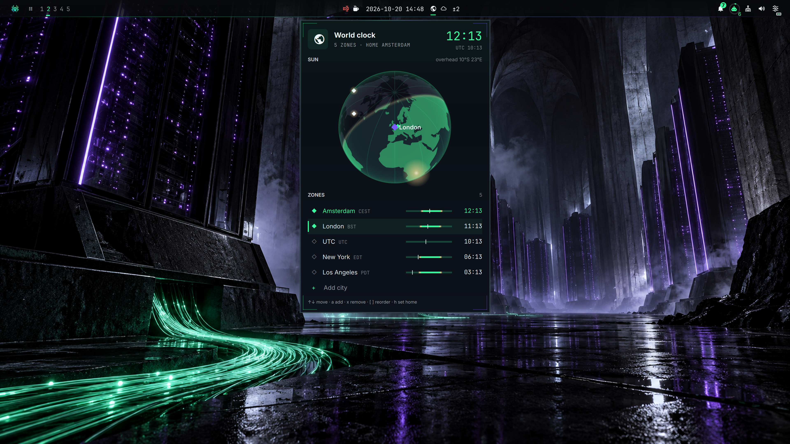

# Features

Aranea brings the command menu, desktop panels, notifications, authentication
prompts, and application styling into one visual system. This guide explains
where to find the controls; [Configuration](configuration.md) covers changing
them, and [Workflows](workflows.md) covers project work.

## Command center

Click the spider button to open the command center. **Files**, **Terminal**, and
**Projects** sit above a compact list of **Apps**, **Actions**, **Software**,
**Settings**, **Help**, and **System**. Apps keeps favorites and recently used
applications. Software groups installation, removal, and updates; desktop
preferences live in **Settings → Aranea**. Select an application and press
**Ctrl+P** to pin or unpin it; Apps keeps up to twelve favorites.

Typing at the root searches applications, commands, open windows, workspaces,
projects, settings, and quick actions. Use a prefix to narrow your search:

| Prefix                   | Find                               |
| ------------------------ | ---------------------------------- |
| `app:`                   | Installed applications.            |
| `command:`               | Menu commands.                     |
| `window:` / `workspace:` | Existing windows or workspaces.    |
| `project:`               | Registered projects and checkouts. |
| `setting:`               | Settings destinations.             |
| `action:`                | Desktop quick actions.             |

A submenu searches its own entries. **Search everywhere** or **Ctrl+F** returns
to the root with your query intact. Results stop at 50 matches; add more detail
if the menu asks you to refine the search.

Quick actions can change Do not disturb, select an available audio output, or
apply an installed wallpaper without closing the menu. They show the current
choice and any active schedule. Selecting a wallpaper leaves an enabled
schedule in place, so its next transition can change the image again.

## Network, Audio, and System

Related controls share three panels:

| Panel   | Pages and controls                                              | Page shortcuts |
| ------- | --------------------------------------------------------------- | -------------- |
| Network | Connections, VPN profiles and sessions, Bluetooth devices.      | `N`, `V`, `B`  |
| Audio   | Output and input devices, app streams, volume, microphone mute. | Panel hints    |
| System  | Power, display controls, resources and Health issues.           | `P`, `D`, `S`  |

Network uses the linked-node icon. Bluetooth's power shortcut is `T` inside
Network. VPN includes NetworkManager and supported own-app profiles, connection
controls, session details, and traffic graphs.

System uses the adjustments icon and opens Power by default. It remains
available without a battery. Display contains brightness, night light, keyboard
light, scaling, and monitor controls. Health includes CPU, memory, disk, and
optional process details, with resource sections expanded initially.

The microphone badge appears only during active capture and reflects the
source's mute state. Notifications and Agents remain separate bar controls;
the tray opens through its disclosure.

## Clock

Click the time to open one dropdown anchored below that clock. **Calendar** is the
default page; choose **World Clock** or **Weather** from the tabs. The separate globe
and weather buttons are consolidated into this control. Existing calendar settings,
city lists, home city, weather location, units and refresh preferences are retained.
Changing pages cancels unfinished edits. Weather's unit and refresh controls remain
available in its page; the other pages keep their existing controls and keys.

## World clock

Select **World Clock** in the time dropdown, or press **Super+Ctrl+Alt+E** to open it directly.
The Earth shows real land, daylight, the day/night boundary, and the point where
the sun is overhead. Hover or select a city to centre the globe there; drag to
turn it, then let it return home. Each row shows the local time, current time-zone
abbreviation, and a daylight strip. Times follow the system time-zone database.

Press **A** or choose **Add city** to search the bundled offline catalogue.
Use **↑/↓** and **Enter** to add a match, or **Esc** to cancel. In the city list,
**X** removes a city, **[ / ]** reorders it, and **H** makes it home. The home city
cannot be removed; setting home changes this widget only. **Tab** moves to the
next dropdown and **Esc** closes it. UTC can be added again through search.

A new list starts with Amsterdam, London, UTC, New York, and Los Angeles.
An untouched Elsewhen default list is replaced by that set; edited city lists
are retained, including entries without map coordinates. City and land data
are bundled from Omarchy Elsewhen, © Jason Fried / Omarchy, under the MIT licence.

## Update center

The update center shows repository packages and AUR packages separately, plus
whether a reboot is required. It checks at startup, hourly, and when opened;
AUR checks require `yay`. A failed check retains the last valid result and shows
**Check failed**. Install updates with **Command center → Software → Update**,
which uses Omarchy's updater.

See [update troubleshooting](troubleshooting.md#updates-appear-empty-or-stale)
when a source cannot be checked.

## Notifications and health

Notifications collect in the notification center. Ordinary waiting items use a
mint indicator; critical items use red. Do not disturb and configured quiet
hours control notification behavior. In the notification center, critical notifications stay until dismissed;
their toast disappears after one minute. History is capped at 100 items,
pruning ordinary entries first.

Health is always available in **System → Health**. An additional shortcut
appears while issues or their alert popup are present. Select an issue to open
diagnostics and recovery choices. Opening diagnostics alone does not restart
services or containers. For an intentionally stopped container, you can
acknowledge that particular stop without hiding future failures.

See [Health recovery](troubleshooting.md#resolve-a-health-issue).

## Clipboard and emoji

The clipboard picker labels links, paths, colors, code, images, and text. Pinned
entries stay above recent history, and likely secrets are masked. Unpinned
secrets expire after ten minutes by default; the retention override is described
in [Configuration](configuration.md#environment-variables). The emoji
picker offers recent emoji and lets you insert or copy a selection.

## Secure prompts

Privileged actions use an Aranea authentication card showing the request,
account, action details, and authentication state.

## Passwordless sudo

The sudo control stays visible in the bar. White means passwordless sudo is
enabled; a dimmed icon means it is disabled. Its tooltip describes the current
state and click action.

Click while enabled to disable it. Click while disabled to open Omarchy's
duration picker: **15 minutes**, **1 Hour**, **1 Day**, or **Permanently**.
Enabling uses Omarchy's confirmation and password authentication. Cancelling or
failing authentication leaves it disabled. Temporary grants expire through
Omarchy's existing timers, and the bar follows those changes.

## Wallpapers and motion

Choose from thirty scenes, with **Silken Vault** as the default. The
collection includes city, rail, rooftop, desert, ocean, orbital, and interior
scenes. **Neural Deck** is the command room; **Ghost in the Wire** is the
cybernetic portrait. [The catalog](configuration.md#wallpapers) lists their
stable command-line IDs, which sometimes differ from the displayed titles.

Twelve scenes have 3840×2160 delivery images; **Orbital Relay** is 3840×1280.
Sources, prompts, and export details are in [Artwork](../backgrounds/ARTWORK.md).

In **Settings → Aranea → Schedule**, create as many daily time/image entries as
you need, keeping at least one. Entries use unique 24-hour times and take effect
when saved. Motion has a separate on/off control in Appearance.

## Desktop settings

**Command center → Settings → Aranea** opens a centered window with Appearance,
Display, Schedule, Integrations, and Notifications pages. Longer pages scroll
inside the window, and navigation retains your drafts.

Wallpaper and display scale use explicit **Apply** and **Discard** controls.
Fonts also require **Apply**; resetting fonts changes the draft. Schedule entries
use **Save schedule**. Motion, integration toggles,
and Do not disturb apply immediately. The Appearance wallpaper chooser stays
collapsed until you request it; font choices offer search and preview samples.
Display accepts decimal scales and distinguishes effective scaling from whether
it was saved for later sessions.

## Project workspaces

**Command center → Projects** opens a searchable project manager. **Add project**
registers an exact Git repository and opens its Git-led Overview immediately.
Agents, saved actions and tool preferences are optional follow-up settings.
**Scan development folder** offers bulk discovery; a scan registers nothing
until you choose **Add selected**.

Each project remembers named profiles and its selected checkout. **Start working**
starts the remembered tools on an empty workspace; **Choose another profile** is
searchable and starts the chosen combination immediately. Existing environments stay
open. **Return** focuses an exact saved environment without starting missing tools.
Overview keeps launch-time context and per-tool results; Profiles holds advanced
configuration. Saved metadata alone does not prove that a window is still running,
and Return does not restore editor or terminal contents. Removing a registration
leaves the repository and existing windows in place.

On a horizontal bar, a workspace linked to one registered checkout shows a
compact project name beside its numbers, with branch and path in the tooltip. Click it to inspect that
exact checkout in Projects. Inspection preserves the saved checkout preference
and uses the existing draft decision before leaving an editor. Launch-time
branches are labeled **at launch** in the tooltip; conflicting associations leave the ordinary
workspace controls visible.

Overview opens with an activity summary when action or agent observations exist.
Its links open Actions or Agents. Running services, latest check results,
reported input and review requests, and disconnected agents remain distinct.

Follow [Set up your first project](workflows.md#set-up-your-first-project).

## Project commands and previews

Save test commands, builds, and development servers as named **Actions**. Each
action uses an executable, separate argument fields, and a working folder inside
the selected checkout. **Save** defines it; **Run** or **Start** executes it.
Opening a project or reloading the shell never runs saved actions automatically.

Projects suggests commands the repository already declares (package.json,
Composer, Makefile, justfile, Cargo, pyproject.toml). Adding one saves it;
running stays a separate choice.

Commands report completion and exit status. Services report their running state
and can have a local preview URL. **View logs**, **Stop**, and **Restart** operate
on the selected run. Runs continue when you close the panel; services do not
have automatic startup or restart. A reachable preview does not establish which
process owns the port, and a successful action does not verify an agent's task.

The [workflow examples](workflows.md#example-run-tests) show how to configure
both kinds. Automation uses the [public CLI](agent-interface.md#configured-project-actions-and-retained-runs).

## Integrations

Profiles select supported application integrations, including terminal,
developer, browser, media, and Qt styling. You can inspect their state and
activate or deactivate them individually in **Settings → Aranea → Integrations**.
Managed changes use backups; customized files are preserved during restoration.
See [Profiles](configuration.md#profiles) and [Integrations](configuration.md#integrations).

## More surfaces

Aranea also includes lock screen, optional Plymouth splash, Cava, GTK, cursor,
icon, browser, terminal, and media artwork or styling. Some integrations provide
assets for manual use rather than rewriting an application profile. The
[README showcase](../README.md) shows the desktop; integration-specific notes
live under [integrations](../integrations/).
