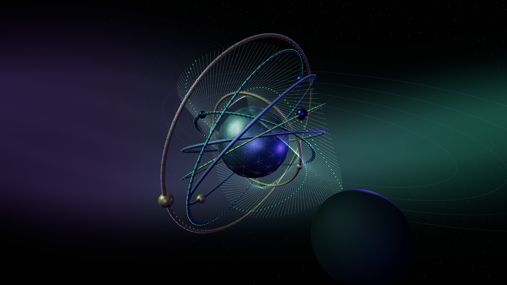
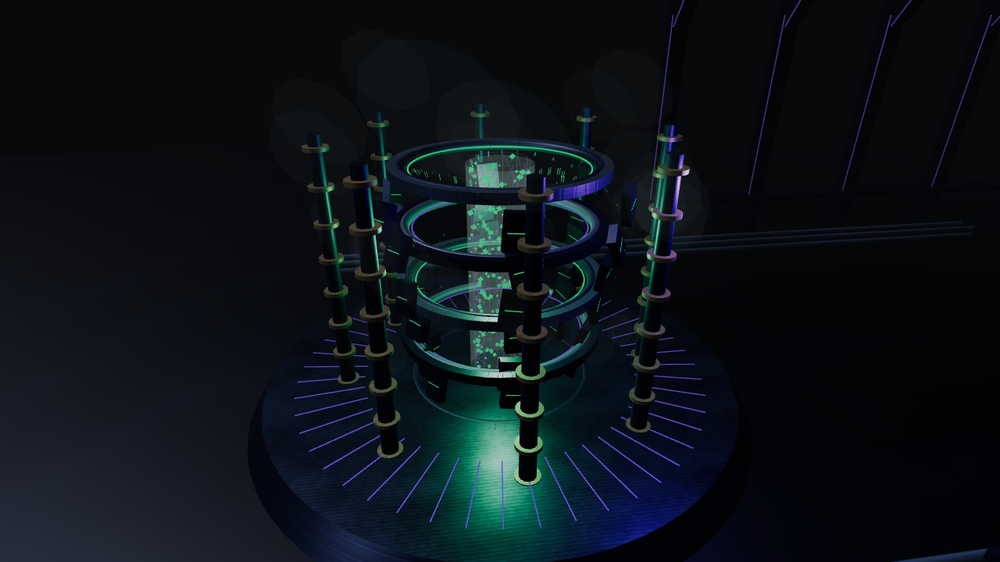
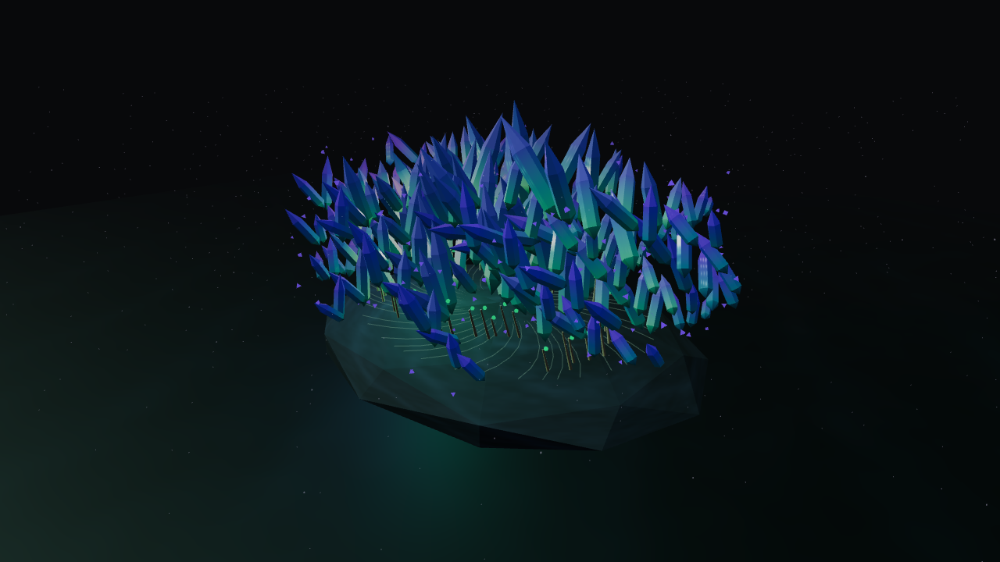

# Aranea gallery

[Back to the README](../README.md) · [Documentation](README.md)

Explore Aranea's desktop, command center, project tools, and everyday controls.
Wallpapers and idle scenes round out the appearance options.

[Desktop](#desktop-surfaces) · [Command center](#command-center) · [Projects](#projects) · [Controls](#bar-controls) · [Wallpapers](#wallpapers) · [Screensavers](#screensavers)

Desktop captures use **Silken Vault**. Agent usage captures show Codex with
demonstration data.

## Desktop surfaces

### Desktop

The bar, command center, notifications, and project tools share one desktop.

### Command center

Launch apps, search for a project or desktop destination, and reach Settings
from the command center.

| Menu                                     | System submenu                                     | Search                                         |
| ---------------------------------------- | -------------------------------------------------- | ---------------------------------------------- |
|  |  |  |

| Input                                        | Apps                             | Favorites and Recent                                                               |
| -------------------------------------------- | -------------------------------- | ---------------------------------------------------------------------------------- |
|  |  |   |

### Projects

Move between projects, inspect task checkouts and Git changes, and start saved
actions. The overview, quick switcher, and review views show different parts
of that workflow.

| Projects                                 | Overview and Git                                                                     | Actions                                                |
| ---------------------------------------- | ------------------------------------------------------------------------------------ | ------------------------------------------------------ |
|  |  |  |

| Problem details                                        | Quick switcher                                         |
| ------------------------------------------------------ | ------------------------------------------------------ |
|  |  |

| Ready for review                                       | Tool preferences                                                    |
| ------------------------------------------------------ | ------------------------------------------------------------------- |
|  |  |

### Bar controls

Network, Audio, and System group related controls into shared panels. The clock
brings Calendar, World Clock, and Weather together; Agents and the tray have
their own views.

| Network: Network                                | Network: VPN                            | Network: Bluetooth                                  |
| ----------------------------------------------- | --------------------------------------- | --------------------------------------------------- |
|  |  |  |

| Audio                                       | Agents: Codex                              | System: Display                                 |
| ------------------------------------------- | ------------------------------------------ | ----------------------------------------------- |
|  |  |  |

| Tray menu                             | Tray management                                    | Filament OSD                            |
| ------------------------------------- | -------------------------------------------------- | --------------------------------------- |
|  |  |  |

| Calendar                              | World clock                                   | Weather                                |
| ------------------------------------- | --------------------------------------------- | -------------------------------------- |
|  |  |  |

### Notifications, health, and session

Review notifications, inspect system health and updates, switch workspaces, and
manage power. Authentication, lock, and boot screens carry the same visual style.

| Health                                      | Notifications                                      | Empty center                                                         |
| ------------------------------------------- | -------------------------------------------------- | -------------------------------------------------------------------- |
|  |  |  |

| Updates                                      | Workspaces                                           | System: Power                               |
| -------------------------------------------- | ---------------------------------------------------- | ------------------------------------------- |
|  |  |  |

| Authentication                                      | Lock screen                             | Boot splash                                          |
| --------------------------------------------------- | --------------------------------------- | ---------------------------------------------------- |
|  |  |  |

### Pickers and applications

Clipboard, emoji, and wallpaper pickers sit alongside matching application
styling for the file manager, Neovim, and Btop.

| Clipboard                                         | Emoji                                      | Wallpaper picker                                     |
| ------------------------------------------------- | ------------------------------------------ | ---------------------------------------------------- |
|  |  |  |

| File manager                                     | Neovim                               | Btop                             |
| ------------------------------------------------ | ------------------------------------ | -------------------------------- |
|  |  |  |

### Appearance and settings

Adjust appearance and display scaling, or choose how the wallpaper changes
through the day. See [Configuration](configuration.md) for the controls behind
these views.

| Appearance                                          | Display scaling                                                  |
| --------------------------------------------------- | ---------------------------------------------------------------- |
|  |  |

## Wallpapers

Thirty wallpapers range from city streets and command rooms to ocean, orbit,
gardens, and polar ice. **Silken Vault** is the default. Choose a single backdrop
or build a daily schedule in Settings.

See [wallpaper settings and titles](configuration.md#wallpapers) and
[artwork sources and prompts](../backgrounds/ARTWORK.md).

| Signal Shrine                                               | Aranea Core                                             | Neural Deck                                         |
| ----------------------------------------------------------- | ------------------------------------------------------- | --------------------------------------------------- |
|  |  |  |

| Rain City                                       | Silent Vault                                         | First Departure                                      |
| ----------------------------------------------- | ---------------------------------------------------- | ---------------------------------------------------- |
|  |  |  |

| Dead Frequency                                      | Black Signal                                        | Undercity                                       |
| --------------------------------------------------- | --------------------------------------------------- | ----------------------------------------------- |
|  |  |  |

| Ghost in the Wire                                            | Violet Pursuit                                                | Deep Current                                              |
| ------------------------------------------------------------ | ------------------------------------------------------------- | --------------------------------------------------------- |
|  |  |  |

| Orbital Relay                                           | Canopy Circuit                                                | Polar Freight                                               |
| ------------------------------------------------------- | ------------------------------------------------------------- | ----------------------------------------------------------- |
|  |  |  |

| Lunar Weaver                                              | Abyssal Sanctum                                                 | Ghost Weaver                                              |
| --------------------------------------------------------- | --------------------------------------------------------------- | --------------------------------------------------------- |
|  |  |  |

| Skyline Sentinel                                                  | Frostbound Nexus                                                  |
| ----------------------------------------------------------------- | ----------------------------------------------------------------- |
|  |  |

| Prism Weaver                                              | Forge of Silk                                               |
| --------------------------------------------------------- | ----------------------------------------------------------- |
|  |  |

| Basalt Covenant                                                 | Silken Vault (default)                                    |
| --------------------------------------------------------------- | --------------------------------------------------------- |
|  |  |

| Orbital Sigil                                               | Echo Basin                                            |
| ----------------------------------------------------------- | ----------------------------------------------------- |
|  |  |

| Glass Tide                                            | Vector Garden                                               |
| ----------------------------------------------------- | ----------------------------------------------------------- |
|  |  |

| Midnight Switchyard                                                     | Quiet Singularity                                                   |
| ----------------------------------------------------------------------- | ------------------------------------------------------------------- |
|  |  |

## Screensavers

Nine animated scenes extend the desktop's palette into idle time. Choose one
or shuffle the collection in **Settings → Aranea → Screensavers**; see
[selection and timing](configuration.md#choose-screensavers-and-timing).
Click a scene to view its full-resolution capture.

| Silk Journey                                                                                                                                                     | Neon Weaver                                                                                                                                                            | Spiderfall                                                                                                                                               |
| ---------------------------------------------------------------------------------------------------------------------------------------------------------------- | ---------------------------------------------------------------------------------------------------------------------------------------------------------------------- | -------------------------------------------------------------------------------------------------------------------------------------------------------- |
|  A spider explores a silk-lit chamber. |  Luminous threads cross cyberpunk architecture. |  Silk descents through a neon shaft. |

| Kanji Drift                                                                                                                                                     | Silken Flow                                                                                                                                                           | Neon Depths                                                                                                                                                           |
| --------------------------------------------------------------------------------------------------------------------------------------------------------------- | --------------------------------------------------------------------------------------------------------------------------------------------------------------------- | --------------------------------------------------------------------------------------------------------------------------------------------------------------------- |
|  Kanji dissolve into drifting particles. |  Ribbons flow through mint and violet auroras. |  A journey through an evolving geometric city. |

| Orbital Loom                                                                                                                                                          | Blackglass Foundry                                                                                                                                                                       | Crystal Bloom                                                                                                                                                              |
| --------------------------------------------------------------------------------------------------------------------------------------------------------------------- | ---------------------------------------------------------------------------------------------------------------------------------------------------------------------------------------- | -------------------------------------------------------------------------------------------------------------------------------------------------------------------------- |
|  Luminous rings surround an eclipsing core. |  Obsidian machinery surrounds a molten core. |  Mineral petals form around a luminous heart. |

See [Visual language](visual-language.md) for the design system behind
these surfaces.
