# Aranea gallery

[Back to the README](../README.md) · [Documentation](README.md)

Browse the desktop, screensavers, and wallpapers below. Agent usage captures
show Codex with demonstration data; desktop backdrops use **Silken Vault**.
Click a screensaver image to open its full-resolution capture.

[Screensavers](#screensavers) · [Desktop surfaces](#desktop-surfaces) · [Wallpapers](#wallpapers)

## Screensavers

Six live scenes share Aranea's dark, mint, violet, and restrained gold palette.
These are fullscreen captures of the running scenes. Choose one or shuffle the
collection in **Settings → Aranea → Screensavers**; see
[selection and timing](configuration.md#choose-screensavers-and-timing).

### With the spider

**Silk Journey**: An articulated spider explores a moving silk-lit chamber.

[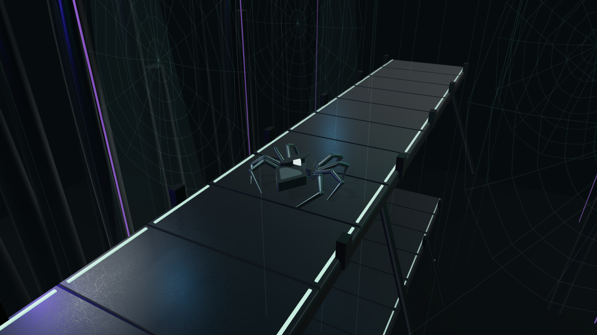](../screenshots/screensaver-silk-journey.png)

**Neon Weaver**: A spider weaves luminous threads across dark cyberpunk architecture.

[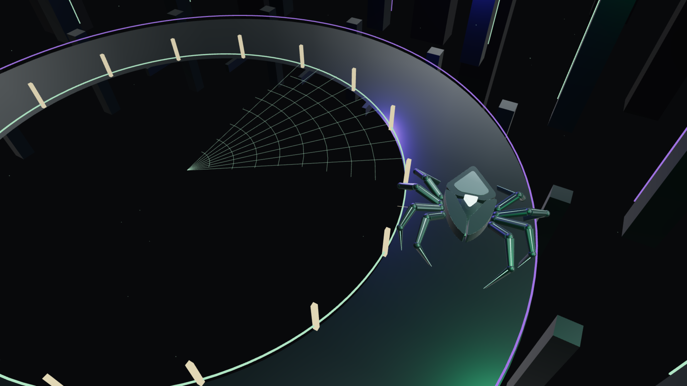](../screenshots/screensaver-neon-weaver.png)

**Spiderfall**: Silk descents through a shifting neon-lit vertical shaft.

[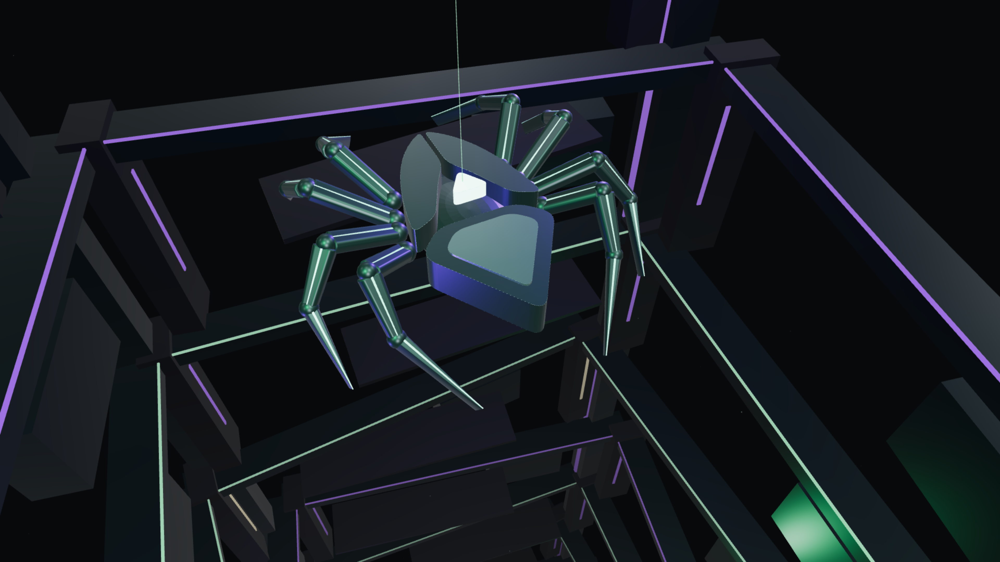](../screenshots/screensaver-spiderfall.png)

### Without the spider

**Kanji Drift**: Layered kanji dissolve into drifting particles and reform in the dark.

[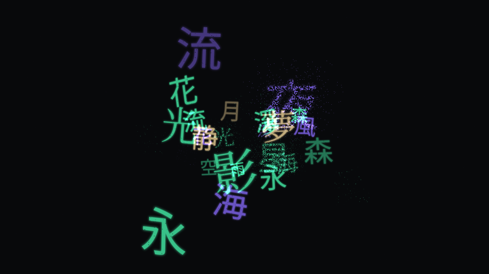](../screenshots/screensaver-kanji-drift.png)

**Silken Flow**: Luminous silk ribbons flow through mint and violet auroras.

[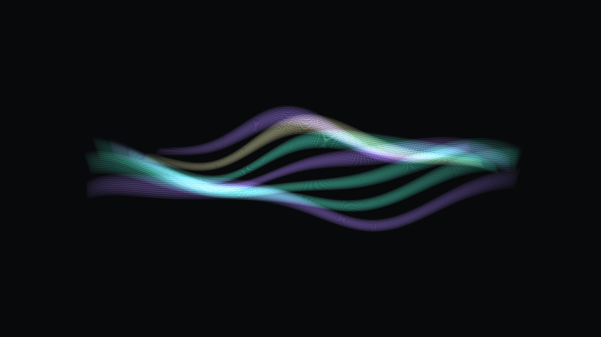](../screenshots/screensaver-silken-flow.png)

**Neon Depths**: A continuous journey through an evolving geometric city.

[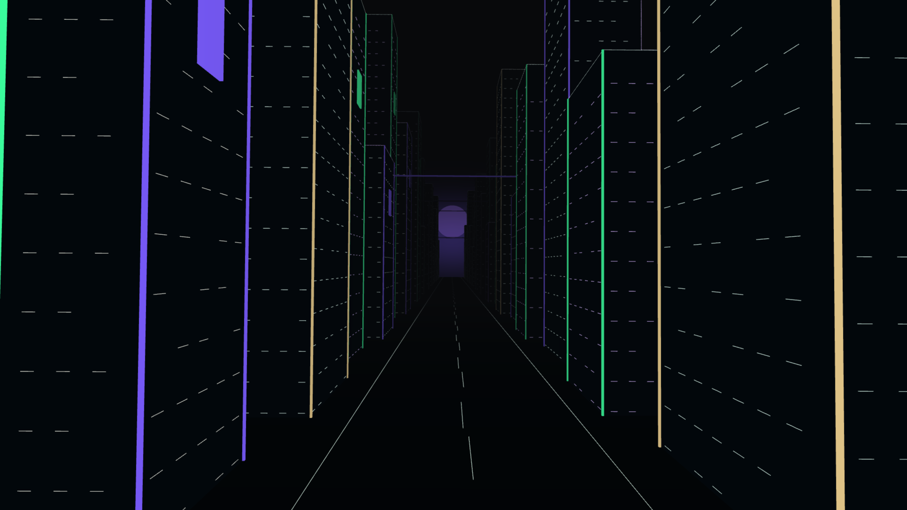](../screenshots/screensaver-neon-depths.png)

## Desktop surfaces

### Desktop and settings

| Desktop                                | Appearance                                                                   | Display scaling                                                  |
| -------------------------------------- | ---------------------------------------------------------------------------- | ---------------------------------------------------------------- |
|  |  |  |

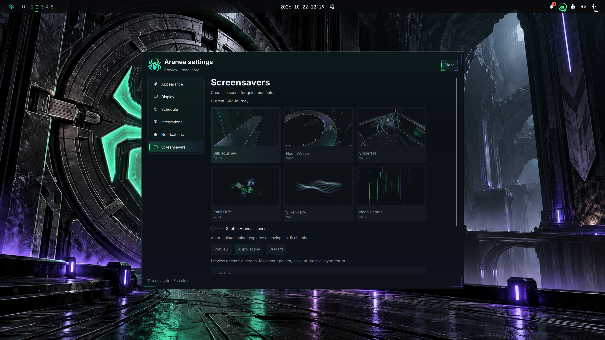

### Command center

| Menu                                     | System submenu                                     | Search                                         |
| ---------------------------------------- | -------------------------------------------------- | ---------------------------------------------- |
|  |  |  |

| Input                                        | Apps                             | Favorites and Recent                                                               |
| -------------------------------------------- | -------------------------------- | ---------------------------------------------------------------------------------- |
|  |  |   |

### Health, notifications, and session

| Health                                      | Notifications                                      | Empty center                                                         |
| ------------------------------------------- | -------------------------------------------------- | -------------------------------------------------------------------- |
|  |  |  |

| Updates                                      | Workspaces                                           | System: Power                               |
| -------------------------------------------- | ---------------------------------------------------- | ------------------------------------------- |
|  |  |  |

| Authentication                                      | Lock screen                             | Boot splash                                          |
| --------------------------------------------------- | --------------------------------------- | ---------------------------------------------------- |
|  |  |  |

### Bar controls

| Network: Network                                | Network: VPN                            | Network: Bluetooth                                  |
| ----------------------------------------------- | --------------------------------------- | --------------------------------------------------- |
|  |  |  |

| Audio                                       | Agents: Codex                              | System: Display                                 |
| ------------------------------------------- | ------------------------------------------ | ----------------------------------------------- |
|  |  |  |

| Tray menu                             | Tray management                                    | Filament OSD                            |
| ------------------------------------- | -------------------------------------------------- | --------------------------------------- |
|  |  |  |

| Calendar                              | World clock                                   | Weather                                |
| ------------------------------------- | --------------------------------------------- | -------------------------------------- |
|  |  |  |

### Projects

| Projects                                 | Overview and Git                                                                     | Actions                                                |
| ---------------------------------------- | ------------------------------------------------------------------------------------ | ------------------------------------------------------ |
|  |  |  |

| Plain problem with Details                                        | Quick switcher                                         |
| ----------------------------------------------------------------- | ------------------------------------------------------ |
|  |  |

| Ready for review                                       | Preferences: a terminal and an agent, no editor                |
| ------------------------------------------------------ | -------------------------------------------------------------- |
|  |  |

### Pickers and applications

| Clipboard                                         | Emoji                                      | Wallpaper picker                                     |
| ------------------------------------------------- | ------------------------------------------ | ---------------------------------------------------- |
|  |  |  |

| File manager                                     | Neovim                               | Btop                             |
| ------------------------------------------------ | ------------------------------------ | -------------------------------- |
|  |  |  |

## Wallpapers

Thirty different scenes share obsidian, mint, and violet: alleys, command rooms,
rail, rooftops, desert, markets, a cybernetic portrait, open road, ocean, orbit, suspended gardens, and polar ice.
Human titles appear in the picker; stable IDs preserve selections and schedules.
See the [title/ID map](configuration.md#wallpapers) and
[artwork sources and prompts](../backgrounds/ARTWORK.md).

| Signal Shrine                                               | Aranea Core                                             | Neural Deck                                         |
| ----------------------------------------------------------- | ------------------------------------------------------- | --------------------------------------------------- |
|  |  |  |

| Rain City                                       | Silent Vault                                         | First Departure                                      |
| ----------------------------------------------- | ---------------------------------------------------- | ---------------------------------------------------- |
|  |  |  |

| Dead Frequency                                      | Black Signal                                        | Undercity                                       |
| --------------------------------------------------- | --------------------------------------------------- | ----------------------------------------------- |
|  |  |  |

| Ghost in the Wire                                            | Violet Pursuit                                                | Deep Current                                              |
| ------------------------------------------------------------ | ------------------------------------------------------------- | --------------------------------------------------------- |
|  |  |  |

| Orbital Relay                                           | Canopy Circuit                                                | Polar Freight                                               |
| ------------------------------------------------------- | ------------------------------------------------------------- | ----------------------------------------------------------- |
|  |  |  |

| Lunar Weaver                                              | Abyssal Sanctum                                                 | Ghost Weaver                                              |
| --------------------------------------------------------- | --------------------------------------------------------------- | --------------------------------------------------------- |
|  |  |  |

| Skyline Sentinel                                                  | Frostbound Nexus                                                  |
| ----------------------------------------------------------------- | ----------------------------------------------------------------- |
|  |  |

| Prism Weaver                                              | Forge of Silk                                               |
| --------------------------------------------------------- | ----------------------------------------------------------- |
| 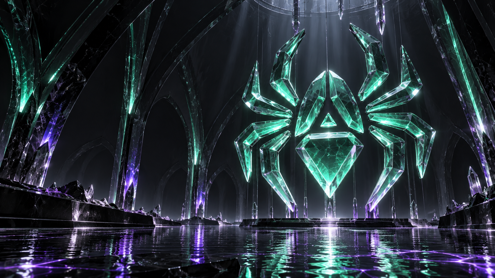 | 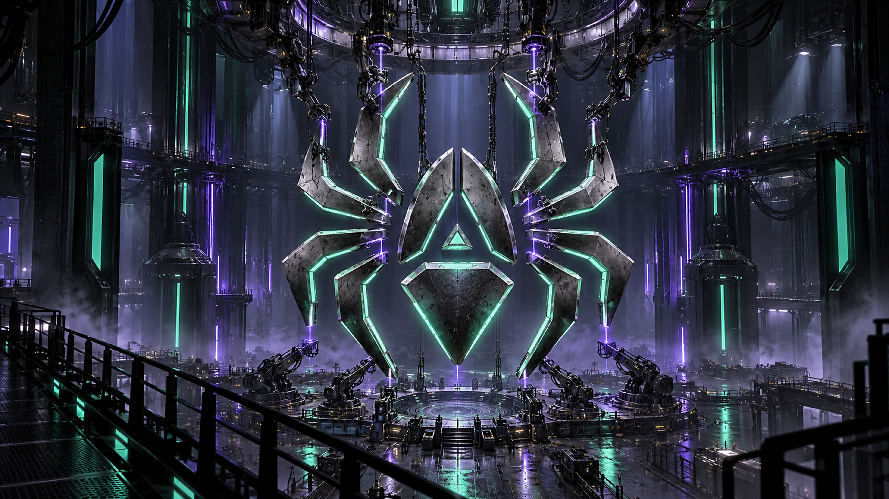 |

| Basalt Covenant                                                 | Silken Vault (default)                                    |
| --------------------------------------------------------------- | --------------------------------------------------------- |
| 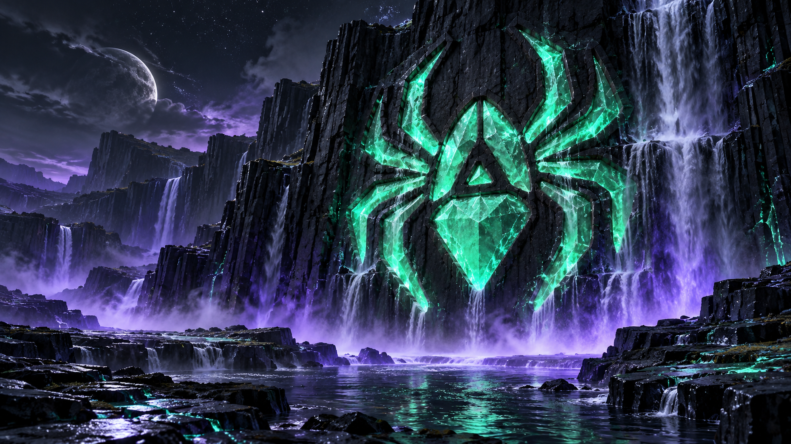 | 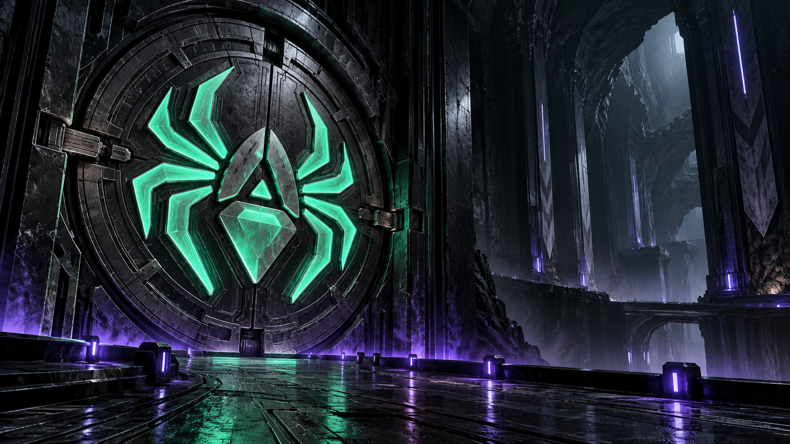 |

| Orbital Sigil                                               | Echo Basin                                            |
| ----------------------------------------------------------- | ----------------------------------------------------- |
| 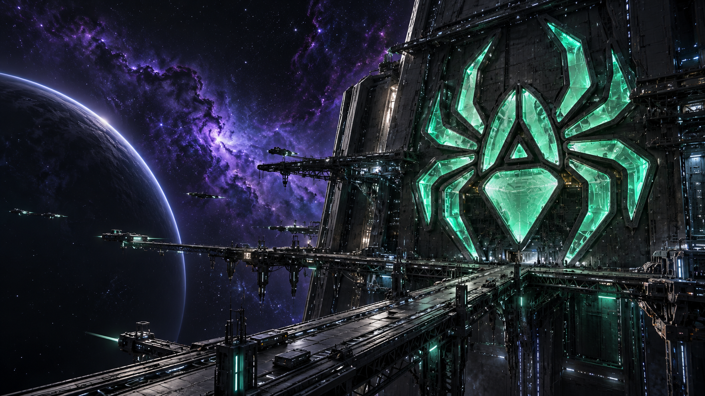 | 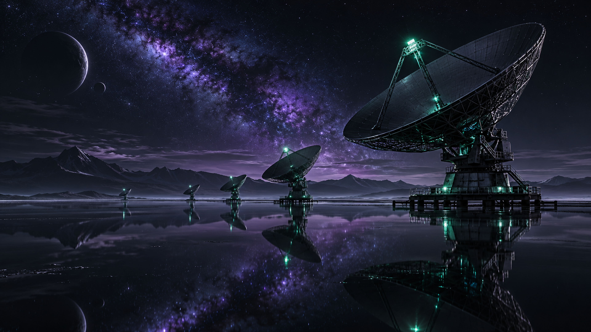 |

| Glass Tide                                            | Vector Garden                                               |
| ----------------------------------------------------- | ----------------------------------------------------------- |
| 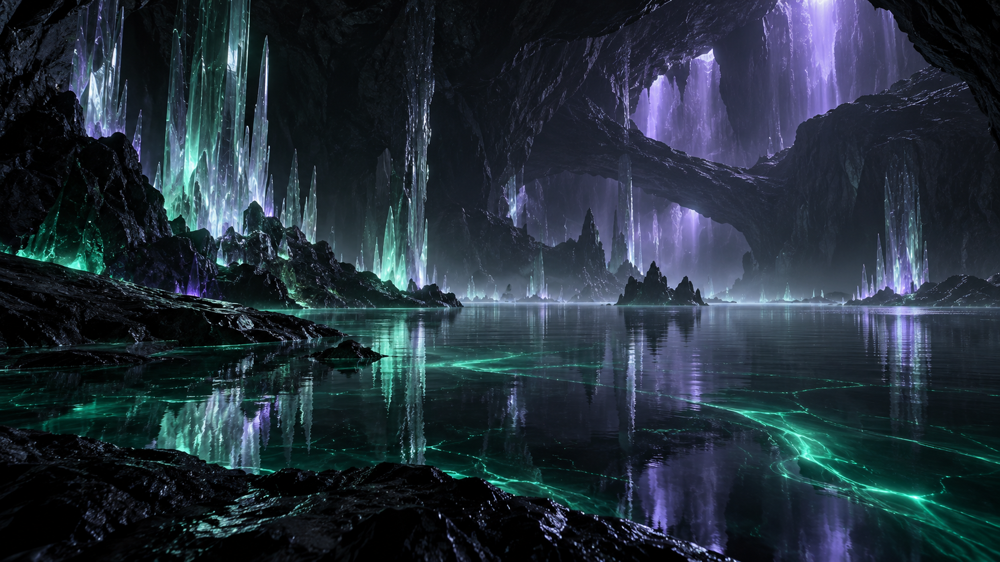 | 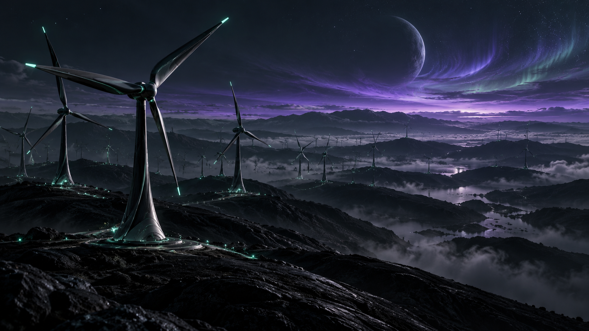 |

| Midnight Switchyard                                                     | Quiet Singularity                                                   |
| ----------------------------------------------------------------------- | ------------------------------------------------------------------- |
| 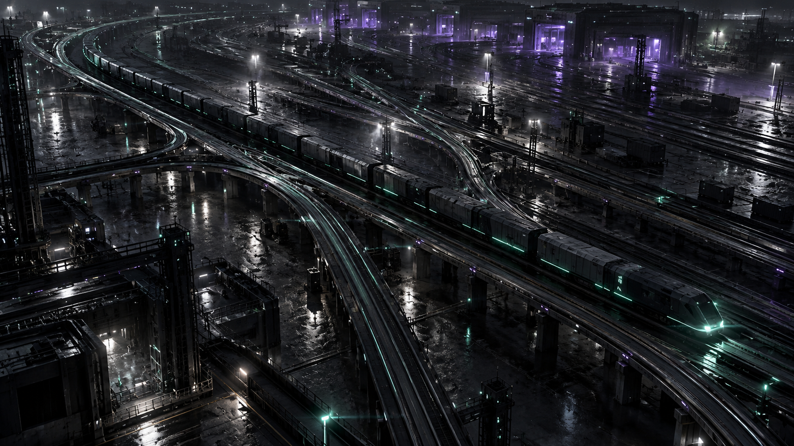 | 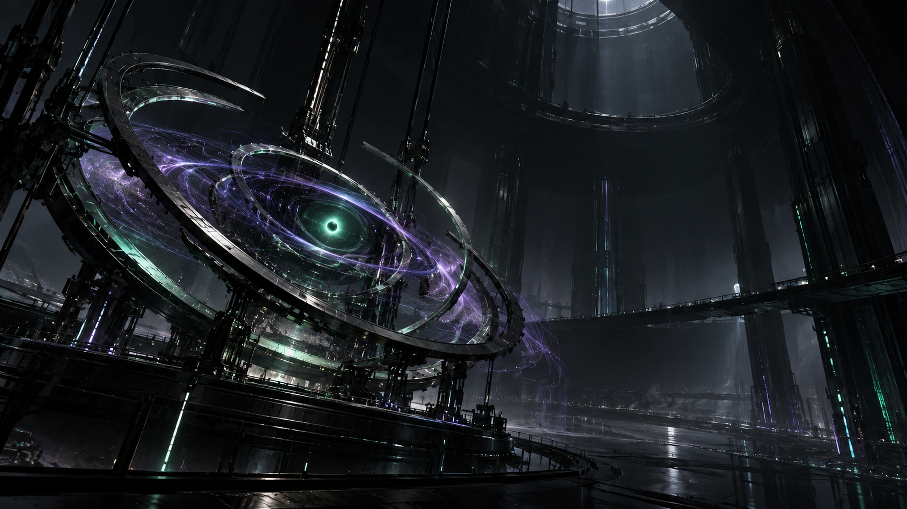 |

See [Visual language](visual-language.md) for the design system behind
these surfaces.
